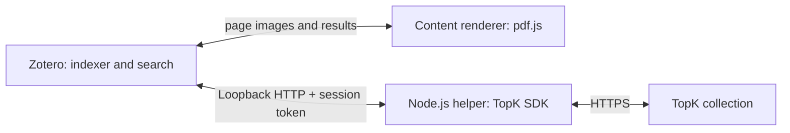

# Architecture

[Back to README](../README.md)

## Runtime boundaries

TopK's JavaScript SDK is a native Node-API module, which Zotero's Gecko runtime
cannot load. The plugin therefore starts a tiny helper process with Node.js
(auto-detected, or set in settings), installs the pinned `topk-js` version
from the shipped lockfile (`npm ci --ignore-scripts`) into
`<Zotero data dir>/topk-bridge/` on first run, and talks to it over
`127.0.0.1` with a per‑session random bearer token. All TopK reads and writes
go through the SDK in that process.

Page rendering happens in a content‑privileged `<browser>` loaded from
`resource://zotero-topk/` with the plugin's own bundled copy of pdf.js, keeping PDF
parsing outside the chrome-privileged plugin context; HTML snapshots are printed
with scripts disabled and all non‑file resources blocked.

## Index format

One TopK document per page:

| field            | type                               |
| ---------------- | ---------------------------------- |
| `_id`            | `"<libraryKey>/<attachmentKey>/<page>"` |
| `page_image`     | `image().required().index(semanticIndex())` |
| `library_key`    | `text()` (`group:<groupID>`, `user:<userID>`, or `local:<localUserKey>`) |
| `library_id`     | `int()` (originating local ID, retained for compatibility) |
| `attachment_key` | `text()`                           |
| `item_key`       | `text()` (parent item, or the attachment itself) |
| `page`, `page_count` | `int()`                        |
| `indexed_pages` | `int()` (completion marker on page 1, including the configured page limit) |
| `title`          | `text()`                           |
| `file_hash`      | `text()` (sha256 of the file, used to skip unchanged files) |

Search: `select({score: fn.semanticSimilarity("page_image", query), …}).filter(field("library_key").in(keys)).sort(field("score"), false).limit(n)`.

Page 1 is uploaded last, with `indexed_pages`, only after every other rendered
page has uploaded successfully. Startup reconciliation accepts only these
completion records. Local state and pending removals are stored separately for
each region, host, collection, and API-key fingerprint; API keys are not written
into the state file. Rotating a key triggers reconciliation with the destination.

Remote group identities use Zotero group IDs, and synced personal libraries use
Zotero user IDs. Unsynced personal libraries use Zotero's local user key. Search
results are translated back to the current installation's local library IDs.

## Index compatibility

Older numeric-library document IDs and local
state cannot safely establish library ownership or upload completion. They are
ignored and current attachments are indexed again under stable IDs. Legacy
remote pages are retained because their ownership is ambiguous across installs;
use a new collection for the upgraded index and retire the old collection when
it is no longer needed. Signing an unsynced personal library into Zotero likewise
moves it from its local identity to its synced user identity.

## Source layout

| Directory | Responsibility |
| --- | --- |
| `addon/` | Zotero lifecycle entry points, content renderer, preferences UI, static assets |
| `src/` | Indexing, helper process management, search, and Zotero UI integration |
| `bridge/` | TopK backend, scoped request scheduling, HTTP server |
| `shared/` | Preferences, runtime requirements, rendering and HTTP contracts |
| `scripts/` | Build, development launcher, runtime checks, and release tooling |
| `test/` | Behavioral regressions, packaged-XPI checks, fixtures and harnesses |

All maintained source is TypeScript. esbuild bundles JavaScript for Zotero and the
helper; only the native TopK SDK stays external to the helper bundle. The build
copies its pinned manifest and lockfile into the XPI. The installed helper is
self-contained apart from that SDK; it does not import files from this checkout.

## Request ordering

The client allows ordinary requests to overlap, but configuration changes wait
for active requests and exclude new ones. The helper schedules requests by
library and attachment: deletions wait for conflicting uploads and deletions,
while reads and uploads can overlap. Every request stays on its side of a
configuration change. Each helper server owns its own queue.

The indexer keeps upload permits until requests settle, even after cancellation.
This prevents an abandoned request from escaping concurrency limits or racing a
later deletion. Page-one completion records are committed only after the rest of
the attachment is durable.

## Security and data handling

- The helper listens on `127.0.0.1` only; every request needs the per‑session
  token (constant‑time compare) and a loopback `Host` header. Deletes and
  manifests are always scoped to one library.
- The API key is stored as a Zotero preference in the Zotero profile and sent
  to the helper over loopback and by the SDK to `https://<region>.api.<host>`; it never appears in logs.
- Errors coming back from TopK are shown as plain text, never interpreted as
  markup. Thumbnail requests return at most 50 images and 8 MiB of JSON.
- Uninstalling the plugin removes the index state, the helper directory and
  the plugin's preferences (including the API key).
- Documents that fail to render are retried at most three times per file
  version; indexing has per‑document size and time limits.
